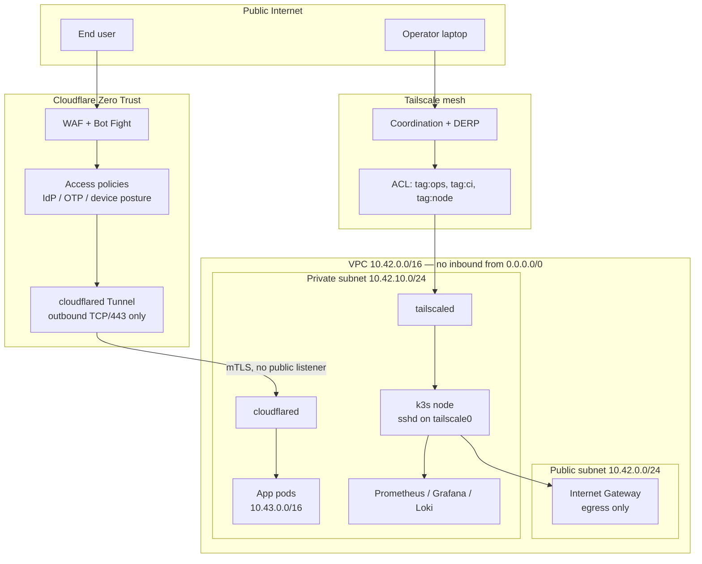
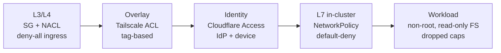

# Zero-Trust Cloud Native Edge

**From traditional network operations (CCNA / CCNP) to a production Cloud Native Network Engineer.**

This repository is a complete, deployable reference for small teams and startups that need a remote engineer who can design, ship, and operate infrastructure independently — with **zero public inbound ports**, predictable cost, and an audit trail.

It is not a collection of blog snippets. It is the pattern I use to take a fresh VPS or AWS account to a locked-down, observable, GitOps-managed edge in a single working day.

---

## The problem this solves

Most “just expose 443 and put Nginx in front” setups fail in the same three ways:

1. **The SSH port is on the internet.** Credential stuffing, 0-days, and “I opened 22 for five minutes” become the incident.
2. **The load balancer / NAT Gateway bill is a surprise.** A $6 VPS grows into a $90 networking invoice.
3. **Nobody can explain the packet path.** When TLS breaks or MTU black-holes a tunnel, the team guesses.

This stack inverts that model:

| Traditional edge | This edge |
| --- | --- |
| Public SSH / 80 / 443 on the host | **No inbound ports at all.** Security group ingress is empty. |
| Users hit your origin IP | Users hit **Cloudflare**; origin only makes outbound connections. |
| Operators VPN into a jump host | Operators join a **Tailscale mesh** with least-privilege ACL. |
| NAT Gateway as default | Public IP with **deny-all ingress** (or a cheap NAT instance) — see [FinOps](docs/finops.md). |
| “We’ll add monitoring later” | Prometheus + Grafana + Loki on day one, private-only. |

Packet path, short version:

```
User ──HTTPS──► Cloudflare Edge (WAF, Access, TLS 1.3)
                      │
                      │ Cloudflare Tunnel (outbound-only TCP/443)
                      ▼
              cloudflared (private)
                      │
                      ▼
              k3s Traefik Ingress ──► workload (non-root, NetworkPolicy)

Operator laptop ──WireGuard──► Tailscale coordination
                      │
                      ▼
              ssh / kubectl / grafana   bound to 100.64.0.0/10 only
```

---

## Architecture



Layered controls (defense in depth, not “the firewall is the security”):



Full CIDR plan, MTU notes, NAT behaviour, and failure domains: **[docs/architecture.md](docs/architecture.md)**.

---

## What you get

| Capability | Where | Production details |
| --- | --- | --- |
| Docker | `docker/` | Multi-stage, distroless, non-root UID 65532, read-only rootfs, healthcheck, CPU/memory limits |
| Cloudflare Zero Trust | `cloudflare/` | Named tunnel, Access policies, no origin certs on disk for public traffic |
| Tailscale | `tailscale/acl.hujson` | Tag-based ACL, CI deploy key, subnet routing optional |
| GitHub Actions | `.github/workflows/` | OIDC-ready, no long-lived cloud keys in the default path, image scan |
| Terraform | `terraform/` | Modular VPC / SG / compute, S3+DynamoDB remote state, `dev` env wired |
| k3s | `k3s/` | Single-node or HA-ready install, Traefik Ingress, default-deny NetworkPolicy |
| Observability | `monitoring/` | Prometheus, Grafana, Loki, Alloy; scrape and dashboards as code |
| FinOps | `docs/finops.md` | NAT Gateway vs public-IP-deny-all vs NAT instance, with monthly numbers |
| Operations | `docs/postmortem-example.md` | A real-style incident write-up (MTU black hole on the tunnel) |

---

## Network design (the part that is not in most DevOps repos)

```
VPC                 10.42.0.0/16      RFC1918, no overlap with office / Tailscale
  public AZ-a       10.42.0.0/24      IGW route; no ENI accepts inbound
  public AZ-b       10.42.1.0/24      spare for NAT instance HA
  private AZ-a      10.42.10.0/24     k3s + tunnel connectors
  private AZ-b      10.42.11.0/24     future HA node
Pod CIDR            10.43.0.0/16      k3s default, isolated from VPC
Service CIDR        10.44.0.0/16      ClusterIP — never routed to the VPC
Tailscale           100.64.0.0/10     CGNAT; never reused as VPC CIDR
Cloudflare WARP     100.96.0.0/12     keep disjoint if WARP is enabled
```

**Why this CIDR layout exists**

- `10.42/16` is unused by AWS defaults (`10.0/16`) and by most office RFC1918, which makes later site-to-site or Tailscale subnet routes unambiguous.
- Pod and Service ranges are **disjoint from the VPC**. Mixing them is how you get “the Service IP is reachable from another node but hairpins on itself.”
- Tailscale’s CGNAT range is called out explicitly so nobody allocates `100.64.0.0/10` “because it looks private.”

**MTU**

| Path | MTU | Why |
| --- | --- | --- |
| VPC Ethernet | 9001 jumbo possible, we pin **1500** | Predictable; jumbo + overlay = silent drops |
| Cloudflare Tunnel (QUIC / HTTP2) | outer 1500, inner **~1280–1400** | Tunnel encapsulation |
| Tailscale WireGuard | **1280** (safe default) | WG + inner TCP MSS |
| Path MTU discovery | ICMP must be allowed **egress + established** | Blocking all ICMP breaks PMTUD and looks like “random hangs on 1500-byte POSTs” |

`scripts/mtu-path-check.sh` measures this instead of guessing.

**NAT / public IP**

The node may have a public IPv4 so it can egress without a $32/mo NAT Gateway. The security group still has **zero inbound rules**. A public address that cannot accept packets is not an attack surface; it is a cheaper default route. The trade-off is documented in [docs/finops.md](docs/finops.md).

---

## Repository map

```
cloud-native-network-engineer/
├── README.md
├── docs/
│   ├── architecture.md          # CIDR, SG, MTU, packet path, failure domains
│   ├── finops.md                # cost model, NAT choices, idle-resource hunt
│   └── postmortem-example.md    # tunnel MTU black hole, 47 minutes
├── terraform/
│   ├── modules/{vpc,security,compute,remote-state}
│   └── environments/dev         # remote state, tagged, apply-ready
├── k3s/
│   ├── install.sh               # hardened single-node / HA bootstrap
│   └── manifests/               # app, Ingress, NetworkPolicy, cloudflared
├── docker/
│   ├── app/                     # Go edge-echo, distroless
│   └── compose/                 # local / single-VPS path
├── monitoring/                  # Prometheus + Grafana + Loki + Alloy
├── cloudflare/                  # tunnel config + Access design
├── tailscale/acl.hujson
├── scripts/                     # bootstrap, verify, MTU, cost snapshot
└── .github/workflows/           # CI (build/scan) + deploy (OIDC)
```

---

## Two delivery paths

Small teams do not all live on AWS. Both paths share the same zero-trust ingress and the same image.

| | Path A — single VPS (Hetzner / DO / Lightsail) | Path B — AWS VPC |
| --- | --- | --- |
| Time to first HTTPS | ~45 minutes | ~90 minutes |
| Monthly floor | ~$6–12 | ~$15–25 without NAT GW |
| Tooling | `docker/compose` or `k3s/install.sh` | `terraform/environments/dev` then k3s |
| Inbound | empty firewall / empty SG | empty SG + NACL deny-all unsolicited |
| Best for | one product, one region | multi-env, audit, future HA |

---

## Quick start (Path A, 15 minutes to a local preview)

Prerequisites: Docker 24+, Compose v2, a Cloudflare account (for the real tunnel), a Tailscale tailnet (for operator access).

```bash
git clone https://github.com/<you>/cloud-native-network-engineer.git
cd cloud-native-network-engineer

# 1. Local stack: app + Prometheus + Grafana + Loki (no public publish)
cp docker/compose/.env.example docker/compose/.env
make dev-up

# 2. Confirm the app never binds a public port on the host
docker compose -f docker/compose/docker-compose.yml port edge-echo 8080
# bound to 127.0.0.1 — Cloudflare / Tailscale are the only doors

# 3. Health, metrics, logs
curl -sS http://127.0.0.1:8080/healthz
curl -sS http://127.0.0.1:8080/metrics | head
```

Grafana: `http://127.0.0.1:3000` (admin / see `.env`). Prometheus: `http://127.0.0.1:9090`.

### Harden a real VPS

```bash
# as root, on a fresh Ubuntu 24.04 box with no cloud firewall holes
sudo ./scripts/bootstrap-host.sh
sudo ./k3s/install.sh
sudo ./scripts/zero-trust-verify.sh
```

`bootstrap-host.sh` installs Tailscale and cloudflared, pins sysctl (rp_filter, bbr, unprivileged ports), and **flushes inbound ACCEPT rules**. After it returns, `ss -lntu` should show listeners on `127.0.0.1` and `100.x` only.

Terraform Path B:

```bash
cd terraform/modules/remote-state && terraform init && terraform apply
cd ../../environments/dev
cp terraform.tfvars.example terraform.tfvars   # fill in account-specific values
terraform init && terraform plan
# apply only after the plan shows 0 ingress rules on the node SG
```

---

## CI / CD

- **CI** (`.github/workflows/ci.yml`) — build the multi-stage image, run Trivy, reject `root` and `latest`-only tags, lint Terraform and YAML.
- **Deploy** (`.github/workflows/deploy.yml`) — GitHub OIDC to cloud / Tailscale; the runner never SSH-listens on the public internet. The node accepts the deploy over Tailscale (`tag:ci` → `tag:node:22`).

Secrets that belong in GitHub Environments, not in git:

| Name | Used by |
| --- | --- |
| `CLOUDFLARE_TUNNEL_TOKEN` | cloudflared (or use cert-free token from Zero Trust) |
| `TAILSCALE_OAUTH_CLIENT_ID` / `SECRET` | CI join, tagged `tag:ci` |
| `GRAFANA_ADMIN_PASSWORD` | compose / k3s Secret |

There is no `AWS_SECRET_ACCESS_KEY` in the happy path. Use OIDC (`role-to-assume`).

---

## Tech stack

- **Compute:** k3s 1.31, containerd, Ubuntu 24.04 LTS
- **Ingress:** Cloudflare Tunnel → Traefik (k3s) or Caddy (compose)
- **Identity:** Cloudflare Access (Google / GitHub IdP), Tailscale ACL tags
- **IaC:** Terraform 1.6+, AWS provider 5.x, remote state with lock
- **App:** Go 1.22, distroless `static-debian12`, `USER 65532`
- **Observability:** Prometheus 2.x, Grafana 11, Loki 3, Grafana Alloy
- **CI:** GitHub Actions, Trivy, `docker/build-push-action`, OIDC

---

## Security posture (checklist I run before handing over)

- [ ] `aws ec2 describe-security-groups` / `ufw status` shows **no** `0.0.0.0/0` inbound
- [ ] `ss -lntu` has no bind on `0.0.0.0:22`, `:80`, `:443`
- [ ] cloudflared is the only process that talks to users
- [ ] sshd `ListenAddress` is the Tailscale IP
- [ ] containers run as UID ≠ 0, read-only rootfs, dropped `NET_RAW`
- [ ] NetworkPolicy default-deny in the app namespace
- [ ] Terraform state in encrypted S3, DynamoDB lock, no local `*.tfstate` in git
- [ ] CI uses OIDC or a Tailscale OAuth client, not a node SSH key in Actions secrets
- [ ] ICMP is not blanket-dropped (PMTUD)
- [ ] `scripts/zero-trust-verify.sh` exits 0

---

## Who this is for

Overseas small teams and startups that need one person to own:

- “Make the site reachable, but I do not want port 22 on Shodan.”
- “Keep the AWS bill under a number I can explain to a founder.”
- “When it breaks at 2 a.m., I want a dashboard and a postmortem template, not a hero.”

If you want a 40-service multi-account landing zone, this is the wrong repo. If you want a **senior network engineer who also ships Kubernetes and CI**, this is the working sample.

---

## Documentation

| Doc | Contents |
| --- | --- |
| [Architecture](docs/architecture.md) | Packet path, CIDR, SG/NACL, MTU, NAT, HA limits |
| [FinOps](docs/finops.md) | Monthly model, NAT Gateway avoidance, idle hunt |
| [Postmortem example](docs/postmortem-example.md) | Cloudflare tunnel MTU black hole |
| [Cloudflare tunnel + Access](cloudflare/tunnel-and-access.md) | Named tunnel, policies, token rotation |
| [SECURITY](SECURITY.md) | Reporting, secret handling, baseline |

---

## License

MIT. Use it, fork it, hire me to run it.

Issues and commercial inquiries: open a GitHub issue or reach me via the address on my GitHub profile.
