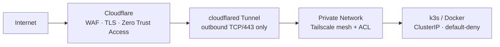
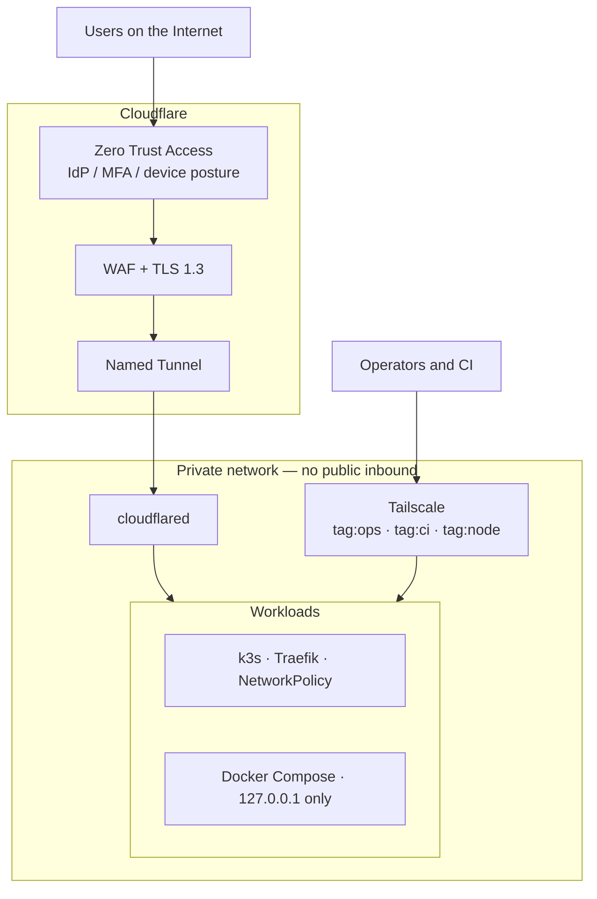

# How to run production workloads with zero public inbound ports

A public SSH port, a public `:443` on the origin, and a load balancer in front of a single node are the default shape of a small production. They are also the default incident.

This repository is a working answer: **users never reach the origin IP**. They terminate on Cloudflare. A named **Cloudflare Tunnel** dials *out* to Cloudflare, so the node does not need an inbound listener. Operators and CI join a **Tailscale** mesh. Workloads run on **k3s** or **Docker**, behind **network segmentation** that is default-deny.

The design is explicit about three properties:

- **No public IP required.** The origin can sit on RFC1918 only. Cloudflare Tunnel and Tailscale are outbound-initiated. There is no A/AAAA record pointing at the node.
- **Zero Trust Access.** Humans prove identity at Cloudflare Access (users) or Tailscale ACL tags (operators / CI). A network path is not a credential.
- **Network segmentation.** VPC / host firewall, Tailscale ACL, Kubernetes NetworkPolicy, and non-root workloads are four separate boundaries. One of them failing closed is enough to stop a class of mistakes.

Cost-aware design: the tunnel and the mesh replace a public load balancer and a NAT Gateway, so a single-region production edge stays in the tens of dollars per month instead of paying enterprise networking defaults for a five-person team.

Packet-level rationale, CIDR plan, MTU, and NAT behaviour: **[docs/architecture.md](docs/architecture.md)**.

---

## Architecture



Two actors, two doors, one private network:



DNS for `app.example.com` is a CNAME to `*.cfargotunnel.com`. Scanning the node — if it even has a public address — returns **no open ports**. SSH, kube-apiserver, Grafana, and Prometheus bind to `100.64.0.0/10` and loopback.

---

## What ships in this repo

| Layer | Path | Production constraints |
| --- | --- | --- |
| Origin image | `docker/app` | Multi-stage, distroless, UID 65532, read-only rootfs, healthcheck, CPU/memory limits |
| Local / VPS | `docker/compose` | Every published port bound to `127.0.0.1` |
| Kubernetes | `k3s/` | Pinned version, disjoint CIDRs, default-deny NetworkPolicy, Traefik as ClusterIP |
| Identity | `cloudflare/`, `tailscale/acl.hujson` | Named tunnel + Access policies; tag-based ACL |
| IaC | `terraform/` | Modular VPC / SG / compute, remote state, empty ingress on the node SG |
| CI/CD | `.github/workflows/` | Build + Trivy; deploy over Tailscale (`tag:ci` → `tag:node`) |
| Observability | `monitoring/` | Prometheus, Grafana, Loki, Alloy — private only |
| Ops | `docs/`, `scripts/` | FinOps model, MTU postmortem, `zero-trust-verify.sh` |

---

## Local reproduction

Requires Docker 24+ and Compose v2. No cloud account is needed for this path. Nothing is published on `0.0.0.0`.

```bash
git clone https://github.com/Kikyo987/cloud-native-network-engineer.git
cd cloud-native-network-engineer

cp docker/compose/.env.example docker/compose/.env
# set GRAFANA_ADMIN_PASSWORD before the first up

make dev-up
```

Confirm the bind address and the app:

```bash
docker compose -f docker/compose/docker-compose.yml port edge-echo 8080
# expected: 127.0.0.1:8080

curl -sS http://127.0.0.1:8080/healthz
# expected: ok

curl -sS http://127.0.0.1:8080/metrics | head
```

Open locally (still loopback):

| Service | URL |
| --- | --- |
| edge-echo | http://127.0.0.1:8080/ |
| Grafana | http://127.0.0.1:3000 |
| Prometheus | http://127.0.0.1:9090 |
| Loki | http://127.0.0.1:3100 |

Optional — attach a real named tunnel to this compose stack (still no inbound ports):

```bash
# put the token from Cloudflare Zero Trust → Networks → Tunnels into .env
# CLOUDFLARE_TUNNEL_TOKEN=...
docker compose -f docker/compose/docker-compose.yml --profile tunnel up -d
```

Tear down:

```bash
make dev-down
```

---

## Cloud deployment

Two paths share the same image, the same tunnel, and the same Tailscale ACL. Pick one.

### Path A — single VPS (Hetzner, DigitalOcean, Lightsail)

Use this for one product, one region. **No public IP required** if the provider gives you a private NIC and egress; if the VPS has a public IPv4, the host firewall still denies all inbound.

On a fresh Ubuntu 24.04 host:

```bash
# 1. Copy the repo (over the provider serial console, or once, before locking SSH)
git clone https://github.com/Kikyo987/cloud-native-network-engineer.git /opt/edge
cd /opt/edge

# 2. Host hardening: deny inbound, pin MTU 1500, install Tailscale + cloudflared
sudo ./scripts/bootstrap-host.sh

# 3. Join the private network
sudo tailscale up --ssh --advertise-tags=tag:node --auth-key=tskey-auth-...

# 4. Bind sshd to the Tailscale IP only
sudo ./scripts/bind-ssh-tailscale.sh

# 5. Named tunnel token — never commit this file
sudo install -m 600 /dev/null /etc/edge/cloudflared.token
echo "$CLOUDFLARE_TUNNEL_TOKEN" | sudo tee /etc/edge/cloudflared.token >/dev/null
sudo cp cloudflare/config.yml /etc/cloudflared/config.yml
sudo systemctl enable --now cloudflared

# 6. Workloads: compose *or* k3s
sudo ./k3s/install.sh
# alternatively: docker compose -f docker/compose/docker-compose.yml up -d

# 7. Prove the posture
sudo ./scripts/zero-trust-verify.sh
sudo ./scripts/mtu-path-check.sh
```

Cloudflare DNS: CNAME `app.example.com` → `<TUNNEL-UUID>.cfargotunnel.com`, proxied. Access policy on that hostname. Do not create an A record to the VPS.

### Path B — AWS VPC (Terraform)

Use this when the customer wants an account they can audit. The node security group has **empty TCP ingress**. NAT Gateway is off unless policy forbids any public address; see [docs/finops.md](docs/finops.md).

```bash
# 1. Remote state (once per account)
cd terraform/modules/remote-state
terraform init
terraform apply \
  -var='project=edge-zero' \
  -var='bucket_name=edge-zero-tf-state-ACCOUNTID' \
  -var='lock_table_name=edge-zero-tf-lock'

# 2. Paste bucket / table / region into terraform/environments/dev/backend.tf

# 3. Dev edge
cd ../../environments/dev
cp terraform.tfvars.example terraform.tfvars
# set flow_logs_bucket; leave enable_nat_gateway = false
# assign_public_ip = true is the cheap egress path (IGW SNAT, still zero inbound)
# assign_public_ip = false requires enable_nat_gateway = true — No public IP required

terraform init
terraform plan
# review: 0 NAT Gateways unless you opted in
# review: no 0.0.0.0/0 TCP ingress on the node SG

terraform apply
```

Then SSM or, once Tailscale user-data has joined, SSH to `100.x` and continue from Path A step 5 (`k3s/install.sh`, tunnel token, `zero-trust-verify.sh`).

### CI

`.github/workflows/deploy.yml` joins the tailnet as `tag:ci` and applies manifests over Tailscale SSH. Required GitHub Environment secrets: `TAILSCALE_OAUTH_CLIENT_ID`, `TAILSCALE_OAUTH_CLIENT_SECRET`. Optional AWS: GitHub OIDC → `vars.AWS_ROLE_ARN`. There is no long-lived `AWS_SECRET_ACCESS_KEY` in the happy path.

---

## Verify before handover

```bash
sudo ./scripts/zero-trust-verify.sh
# FAIL if 0.0.0.0:{22,80,443} is listening
# FAIL if WAN MTU > 1500
# WARN if sshd is not bound to 100.x
```

| Check | Expected |
| --- | --- |
| `ss -lntu` | no `0.0.0.0:22/80/443` |
| `dig +short app.example.com` | Cloudflare anycast, never the origin |
| `curl -sSI https://app.example.com` | Access challenge or 200 after identity |
| Node SG / ufw inbound | empty / deny |
| Container UID | 65532, not 0 |

---

## Documentation

| Doc | Contents |
| --- | --- |
| [Architecture](docs/architecture.md) | Data flow, security boundaries, why this design |
| [FinOps](docs/finops.md) | Monthly model, NAT Gateway avoidance |
| [Postmortem example](docs/postmortem-example.md) | Tunnel MTU black hole |
| [Cloudflare tunnel + Access](cloudflare/tunnel-and-access.md) | Named tunnel, policies, rotation |
| [SECURITY](SECURITY.md) | Reporting and baseline |

MIT license.

---

Cloud Native Network Engineer | Zero Trust · Terraform · k3s · Cloudflare
