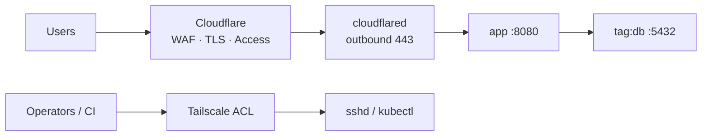

# Cloudflare Zero Trust + Tailscale

How to put a production origin on the internet **without opening a
single inbound port**, and how operators reach SSH and the database
**without a VPN concentrator**.

This is the runbook. Config files next to this document are the
source of truth; the dashboard clicks below produce the same objects.

```
cloudflare/
  tunnel-and-access.md      this file
  config.yml                named tunnel, k3s DNS names
  config.compose.yml        same tunnel, compose DNS names
  systemd/cloudflared.service
  access/                   Access applications + policies (JSON)
  tailscale-acl.hujson      operator + database ACL
```

---

## Why this is safer than a VPN

A traditional remote-access VPN does three things in one box:

1. It **listens on the internet** (UDP/1194, UDP/51820, TCP/443).
2. It **extends a network** — once you are in, RFC1918 is yours.
3. It **treats the laptop as trusted** for the length of the tunnel.

That model fails in predictable ways. The concentrator is in Shodan.
A phished password plus a live tunnel is a path to the database. Split
tunnel is optional and usually off. Split tunnel off means every coffee
shop packet from the laptop hairpins through your VPC.

This design splits the job:

| Job | Traditional VPN | This edge |
| --- | --- | --- |
| Users reach the app | VPN or public `:443` on origin | **Cloudflare Tunnel** — origin dials out |
| Which users | “has the VPN profile” | **Zero Trust Access** — GitHub/Google + MFA, per hostname |
| Operators reach SSH | VPN + security group `:22` | **Tailscale** — identity ACL, no public `:22` |
| App reaches the database | same VPN / same subnet | **Tailscale grant** `tag:app → tag:db:5432` only |
| Inbound on the node | at least the VPN port | **none** |

Three properties follow.

**No public IP is required on the origin.** cloudflared and tailscaled
are outbound clients. The security group has no TCP ingress from
`0.0.0.0/0`. A scanner that finds the Elastic IP (if you even have one)
gets no open ports.

**A network path is not a credential.** Landing on `app.example.com`
still hits Cloudflare Access. Landing on `100.x` still hits the
Tailscale ACL. Stolen SSH keys without a live tailnet membership do
not reach `sshd`. Stolen app cookies without an Access session do not
reach origin.

**Blast radius is tagged, not subnet-wide.** Developers authenticated
to the product never receive SSH. Operators with SSH never receive
`5432` unless you add that grant. The VPN model is “in the CIDR”;
this model is “in the grant”.

What we are not doing: putting Magic WAN, a customer VPN appliance,
and a tunnel in front of the same origin. One inbound story.



---

## 0. Prerequisites

- A Cloudflare account with the zone `example.com` (Free plan is enough)
- A GitHub organization **or** a Google Workspace / Google identity
- A Tailscale tailnet (personal or org)
- A node with **no inbound 22/80/443** (this repo’s Terraform / `bootstrap-host.sh`)
- `cloudflared` on a laptop for the one-time `tunnel create`

Replace `example.com`, `customer.com`, and `REPLACE_*` before applying.

---

## 1. Named tunnel (zero inbound ports)

Quick tunnels (`cloudflared tunnel --url`) get a random
`trycloudflare.com` hostname and die with the process. Named tunnels
survive restarts, take a token, and bind to DNS you control.

### 1.1 Create the tunnel (once, on a laptop)

```bash
# Debian/Ubuntu
curl -fsSL https://pkg.cloudflare.com/cloudflare-main.gpg \
  | sudo gpg --dearmor -o /usr/share/keyrings/cloudflare-main.gpg
echo "deb [signed-by=/usr/share/keyrings/cloudflare-main.gpg] https://pkg.cloudflare.com/cloudflared $(lsb_release -cs) main" \
  | sudo tee /etc/apt/sources.list.d/cloudflared.list
sudo apt-get update && sudo apt-get install -y cloudflared

cloudflared tunnel login          # opens a browser, pick the zone
cloudflared tunnel create edge-zero
cloudflared tunnel list
```

You now have a UUID and a credentials JSON under
`~/.cloudflared/<UUID>.json`. That JSON is a secret. Do not commit it.

On servers, prefer **token auth** so the JSON never touches disk:

1. Zero Trust dashboard → **Networks** → **Tunnels**
2. Open `edge-zero` → **Install connector** → copy the token
3. Store it as `/etc/edge/cloudflared.token` mode `0600`, or as the
   Kubernetes Secret in `k3s/manifests/40-cloudflared.yaml`, or as
   GitHub Actions secret `CLOUDFLARE_TUNNEL_TOKEN`

Rotate by issuing a new token and rolling the process. The UUID and
the DNS records stay. Clients do not notice.

### 1.2 DNS — CNAME to the tunnel, never to the node

```bash
# UUID from `cloudflared tunnel list`
UUID=<TUNNEL-UUID>

cloudflared tunnel route dns edge-zero app.example.com
cloudflared tunnel route dns edge-zero grafana.example.com
```

Or in the DNS UI, two **proxied** (orange-cloud) CNAMEs:

```
app.example.com      CNAME  <UUID>.cfargotunnel.com     proxied
grafana.example.com  CNAME  <UUID>.cfargotunnel.com     proxied
```

Do **not** create an A/AAAA record for the node. That address is an
egress identifier, not an origin. Grey-cloud (DNS only) skips WAF and
Access; leave it orange.

### 1.3 Origin config

k3s path: copy `config.yml` to the ConfigMap (already in
`k3s/manifests/40-cloudflared.yaml`).

VPS / compose path:

```bash
sudo install -d -o cloudflared -g cloudflared -m 0750 /etc/cloudflared /etc/edge
sudo cp cloudflare/config.compose.yml /etc/cloudflared/config.yml   # or config.yml for k3s names
echo "$CLOUDFLARE_TUNNEL_TOKEN" | sudo tee /etc/edge/cloudflared.token >/dev/null
sudo chmod 600 /etc/edge/cloudflared.token
sudo cp cloudflare/systemd/cloudflared.service /etc/systemd/system/
sudo systemctl daemon-reload
sudo systemctl enable --now cloudflared
sudo systemctl status cloudflared --no-pager
```

Two details that are easy to get wrong:

1. **`protocol: auto`** — QUIC, then HTTP/2. After an MTU incident,
   pin `protocol: http2` for a day. See `docs/postmortem-example.md`.
2. **Catch-all `http_status:404`.** Without it, a mistyped hostname on
   the same tunnel is routed to the first ingress rule.

Ingress is first-match. Most specific hostnames at the top.

### 1.4 What the node must allow — outbound only

| Direction | Port | Why |
| --- | --- | --- |
| outbound | TCP/443 | tunnel, registry, IdP |
| outbound | UDP/443 | QUIC |
| outbound | UDP/53, TCP/53 | DNS |
| inbound | anything | **nothing.** Not 7844, not 443, not 80 |

`scripts/zero-trust-verify.sh` fails the node if `0.0.0.0:22/80/443`
is listening.

### 1.5 Confirm the origin is dark

```bash
# from a laptop that is not on the tailnet
dig +short app.example.com
# expect Cloudflare anycast, never the Elastic IP / VPS A record

# from the node
ss -lntu | grep -E '0\.0\.0\.0:(22|80|443|7844)' && echo FAIL || echo "no public listeners"
curl -sS http://127.0.0.1:8080/healthz     # or the ClusterIP
journalctl -u cloudflared -n 50 --no-pager # "Registered tunnel connection"
```

Until Access is attached, `curl -sSI https://app.example.com` may
already return 200 from origin through the tunnel. That is expected.
Section 2 closes it.

---

## 2. Zero Trust Access (GitHub / Google + MFA)

The tunnel makes the origin unreachable by IP. Access decides **which
humans** may use the public hostname. Run both. A tunnel without
Access is a public Cloudflare hostname with a hidden origin — still a
public app.

### 2.1 Add identity providers

Zero Trust dashboard → **Settings** → **Authentication** → **Login
methods** → **Add new**.

**GitHub**

1. GitHub → Settings → Developer settings → OAuth Apps → New
2. Homepage: `https://<your-team>.cloudflareaccess.com`
3. Callback: `https://<your-team>.cloudflareaccess.com/cdn-cgi/access/callback`
4. Paste Client ID / secret into Cloudflare
5. Note the IdP UUID (in the IdP row, or via API). It goes into
   `access/policy-github-mfa.json` as `REPLACE_GITHUB_IDP_UUID`

**Google**

1. Google Cloud Console → APIs → OAuth consent → Web application
2. Authorized redirect: the same `.../cdn-cgi/access/callback`
3. Paste Client ID / secret
4. For Google Workspace, restrict to the `customer.com` domain
5. Note the IdP UUID → `REPLACE_GOOGLE_IDP_UUID`

Do not invent a second password store. GitHub or Google is enough
for a five-person team. Okta when the customer already has it.

### 2.2 Create the applications

Zero Trust → **Access** → **Applications** → **Add an application** →
**Self-hosted**.

**Product (`app.example.com`)** — session 8 hours

1. Application domain: `app.example.com`
2. Identity providers: GitHub and/or Google (the ones you just added)
3. Policy name: `Allow GitHub org + MFA`
   - Action: **Allow**
   - Include: **GitHub organization** = `REPLACE_GITHUB_ORG`
     (or **Emails ending in** `@customer.com` for Google)
   - Require: **Authentication method** → MFA
     (hardware key / TOTP / IdP MFA — `hwk|swk|mfa` in the JSON)
4. Session duration: 8 hours
5. Enable **HTTP Only** cookie, **Binding cookie**

Equivalent API bodies: `access/app-product.json` +
`access/policy-github-mfa.json` (or `policy-google-mfa.json`).

**Grafana (`grafana.example.com`)** — session 12 hours, ops only

1. Domain: `grafana.example.com`
2. Identity providers: GitHub only (narrower)
3. Policy: **Allow**, Include specific emails
   (`ops-lead@customer.com`, `sre@customer.com`)
4. Require: MFA
5. Optional: purpose justification (“Why are you opening Grafana?”)

Equivalent: `access/app-grafana.json` + `access/policy-ops-only.json`.

Do **not** publish Prometheus or Loki on Cloudflare. They stay on
Tailscale (`100.x:9090`, `100.x:3100`) for `group:ops`.

A public marketing page can skip Access and still keep the origin off
the internet. Do not skip Access on Grafana.

### 2.3 Confirm Access is in front of the tunnel

```bash
# unauthenticated laptop
curl -sSI https://app.example.com | head -20
# expect: HTTP/2 302
#         location: https://<team>.cloudflareaccess.com/cdn-cgi/access/login/...

curl -sSI https://grafana.example.com | head -10
# expect: 302 to Access, not 200 from Grafana
```

Sign in with GitHub/Google, complete MFA, then:

```bash
curl -sS https://app.example.com/healthz
# expect: ok
```

A user who is not in the org / not in the email list gets the Access
deny page. Origin logs stay empty — the request never left Cloudflare.

---

## 3. Tailscale ACL (SSH and database)

Users are done. Operators and the application identity live on
Tailscale. The ACL is `tailscale-acl.hujson` (copy also at
`../tailscale/acl.hujson`).

### 3.1 Join the node

```bash
# on the node, after bootstrap-host.sh / cloud-init
curl -fsSL https://tailscale.com/install.sh | sh

# mint an auth key in the admin console:
#   Settings → Keys → Generate auth key
#   reusable: no, ephemeral: no, tags: tag:node
sudo tailscale up --ssh --advertise-tags=tag:node --auth-key=tskey-auth-...

# bind sshd to 100.x so a mistaken ufw hole on :22 is still dark
sudo ./scripts/bind-ssh-tailscale.sh
tailscale ip -4
```

CI uses a **separate** OAuth client tagged `tag:ci` (see
`.github/workflows/deploy.yml`). Do not reuse the node key.

Application identity: either run a tailscale sidecar tagged `tag:app`,
or (small installs) let the node SNAT app egress and grant
`tag:node → tag:db:5432` as in the ACL.

Database: tag the Postgres host `tag:db`, **or** tag a subnet router
that advertises only the RDS ENI /32 — not the whole VPC.

### 3.2 Apply the ACL

Admin console → **Access Controls** → paste `tailscale-acl.hujson`
after replacing:

| Placeholder | Example |
| --- | --- |
| `REPLACE_OPS_LEAD` | your GitHub login |
| `REPLACE_SRE` | teammate GitHub login |
| `REPLACE_DEVELOPER` | a developer who must **not** get SSH |

Save. The ACL is live immediately.

What the file enforces:

| Source | Destination | Ports | Why |
| --- | --- | --- | --- |
| `group:ops` | `tag:node` | 22, 6443, 3000, 9090, 3100 | shells + API + Grafana on the mesh |
| `tag:ci` | `tag:node` | 22 | deploy only |
| `tag:app` | `tag:db` | 5432, 3306 | the only database path |
| `tag:node` | `tag:node` | 6443, 10250, 8472, 51820 | k3s fabric |
| `group:dev` | `tag:node` / `tag:db` | — | **no grant** |
| `autogroup:member` | `autogroup:self` | * | laptops reach themselves |

SSH block: `group:ops` may become `ubuntu`; `root` requires a
Tailscale SSH **check** (second owner). `tag:ci` may become `ubuntu`
only.

There is **no** grant from `group:ops` to `tag:db:5432`. That is
deliberate. A production incident that needs `psql` is a temporary
ACL edit, not a standing VPN route. Revert the grant when the
incident closes.

Do **not** advertise `10.42.0.0/16` as a subnet route. That is how
every laptop becomes a path into RFC1918.

### 3.3 Confirm the ACL

```bash
# as an ops laptop (in group:ops, tailscale up)
ssh ubuntu@$(tailscale ip -4)     # or the node's 100.x
# expect: Tailscale SSH, not a public :22

# as the same laptop, against the database tag
nc -vz <db-100.x> 5432
# expect: timeout / ACL deny. You are not tag:app.

# from the app (on the node, or a tag:app sidecar)
nc -vz <db-100.x> 5432
# expect: connected
```

From a developer laptop in `group:dev`:

```bash
ssh ubuntu@<node-100.x>
# expect: ACL denied
```

---

## 4. TLS, WAF, and cookies

- SSL/TLS mode for the zone: **Full (strict)** is fine toward
  Cloudflare’s own tunnel (mTLS). Origin certs on the node are
  optional and usually omitted; we speak HTTP to ClusterIP.
- Minimum TLS: 1.2, prefer 1.3. Always Use HTTPS: on.
- Bot Fight: on for `app.example.com`.
- Managed WAF: Free plan is enough; the closed origin is the control.
- Access cookies: HTTP Only + Binding cookie, as in the JSON.

---

## 5. End-to-end verification

| Check | Expected |
| --- | --- |
| `dig +short app.example.com` | Cloudflare anycast |
| `curl -sSI https://app.example.com` (logged out) | 302 to Access |
| `curl -sSI https://grafana.example.com` (logged out) | 302 to Access |
| `curl -sSI https://grafana.example.com` (dev GitHub, not ops) | Access deny |
| `ss -lntu` on the node | no `0.0.0.0:22/80/443` |
| `ssh` from ops to `100.x` | Tailscale SSH as `ubuntu` |
| `ssh` from `group:dev` to `100.x` | ACL deny |
| `nc` from a laptop to `tag:db:5432` | ACL deny |
| `nc` from `tag:app` to `tag:db:5432` | connect |
| `scripts/zero-trust-verify.sh` | exit 0 |

---

## 6. Operate

**Rotate the tunnel token.** Zero Trust → Tunnels → `edge-zero` →
refresh token → replace `/etc/edge/cloudflared.token` or the k8s
Secret → `systemctl restart cloudflared` / rollout. DNS stays.

**Rotate Tailscale node keys.** `tailscale logout` then a new tagged
auth key. ACL tags stay; the node’s `100.x` may change — update
`vars.NODE_TAILSCALE_IP` for CI.

**Add an operator.** Put their GitHub login in `group:ops`, save the
ACL. They already have Access if they are in the GitHub org; Grafana
still needs their email on `policy-ops-only.json`.

**Break-glass to the database.** Add a grant
`group:ops → tag:db:5432`, `psql`, delete the grant. Do not leave it.

**MTU.** GET works, POST hangs → pin host MTU 1500, allow ICMP type 3,
optionally `protocol: http2` on the tunnel.
`docs/postmortem-example.md`.

---

## 7. Failure modes

| Symptom | Hop |
| --- | --- |
| 1033 | cloudflared down or token revoked |
| 502 / 1033 flapping | one of two connectors is bad |
| 524 | origin timeout — MTU or app hang |
| Access loop | NTP blocked (clock skew) or cookie domain |
| Access 200 with no MFA | Require rule missing on the policy |
| SSH from the internet | sshd bound to `0.0.0.0` — run `bind-ssh-tailscale.sh` |
| Laptop can `psql` | extra grant or a subnet route for `10.42.0.0/16` |

---

## 8. What this is not

- A replacement for disk encryption, IAM, or Postgres `pg_hba`.
- A reason to publish Prometheus on the internet “because Access exists”.
- Compatible with jumbo frames, “drop all ICMP”, or an ALB in front of
  the same origin.

It is the minimum identity-aware edge that a small team can run
without a VPN appliance and without a public SSH port.

---

Cloud Native Network Engineer | Zero Trust · Terraform · k3s · Cloudflare
