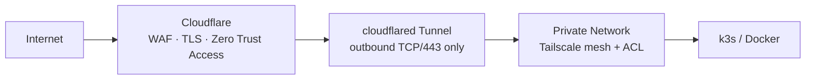
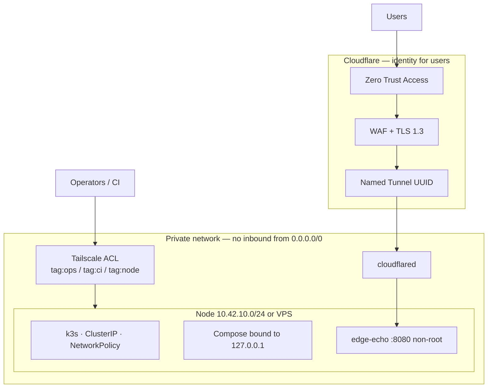
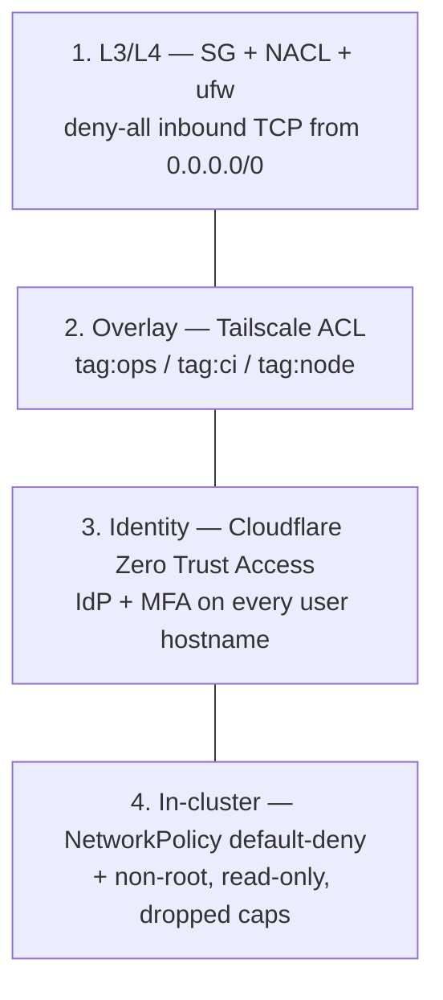

# Architecture

How this edge moves packets, where each security boundary sits, and why the
shape is this one rather than “public `:443` plus a bastion.”

The README is the operator view. This file is the packet view. If a change
alters CIDR, MTU, NAT, identity, or who is allowed to *initiate* a flow, it
belongs here before it belongs in Terraform.

---

## 1. The problem

A typical small-team production looks like this:

```
Internet ──► :22 and :443 on a public IP ──► Nginx / kube ──► app
Operator ──► the same :22
```

That design has three structural issues.

1. The origin is on the internet. Shodan indexes it. A five-minute “open 22
   from my laptop” becomes the incident.
2. Identity is implied by network location. Anyone who can SYN `:443` is a
   user; anyone who can SYN `:22` is an operator.
3. The cost follows enterprise defaults (load balancer, NAT Gateway) even
   when the workload is one node.

The design in this repository inverts initiation:

- Users do not connect to the origin. They connect to Cloudflare. The origin
  dials Cloudflare.
- Operators do not connect to a public SSH port. They join a Tailscale mesh.
- The node can have **no public IP required**. Egress is enough.

Keywords this document holds as invariants:

| Invariant | Meaning here |
| --- | --- |
| **No public IP required** | A private ENI plus outbound 443 is a complete data path |
| **Zero Trust Access** | Cloudflare Access (users) and Tailscale ACL tags (ops / CI) sit in front of every human action |
| **Network segmentation** | VPC/SG, overlay ACL, Kubernetes NetworkPolicy, and the workload itself are independent layers |

Cost-aware design is a constraint, not an afterthought: Cloudflare Tunnel and
Tailscale replace a public load balancer and, in the default AWS path, a NAT
Gateway. Numbers live in [finops.md](finops.md).

---

## 2. Reference diagram





DNS for product hostnames is a CNAME to `<TUNNEL-UUID>.cfargotunnel.com`.
There is no A/AAAA record for the node. If the node has a public IPv4 for
cheap egress, that address is an identifier in someone else’s logs, not a
listener.

---

## 3. Data flows

Three flows exist. They do not share a listener.

### 3.1 User request (HTTPS)

This is the only path a customer packet takes.

```
browser
  │  TLS 1.3, SNI = app.example.com
  ▼
Cloudflare anycast
  │  WAF, Bot Fight, HTTP/2 or HTTP/3
  │  Zero Trust Access: IdP / OTP / device posture
  │  origin = named tunnel UUID  (not an IP)
  ▼
cloudflared   ── outbound TCP/443 or QUIC/443 ──► Cloudflare
  │  in-cluster: http://edge-echo.edge.svc.cluster.local:8080
  │  compose:    http://edge-echo:8080
  ▼
NetworkPolicy / compose bridge  (only cloudflared may connect)
  ▼
edge-echo  UID 65532, :8080, read-only rootfs
```

Properties that follow from this path:

- The kernel on the node never accepts a SYN from a user. Return traffic
  for the tunnel is stateful, matching an outbound flow cloudflared opened.
- TLS to the user is terminated at Cloudflare. Inside the cluster we speak
  HTTP on the pod network. Minting a public origin certificate on the node
  is unnecessary.
- Access is evaluated *before* the request is sent down the tunnel. A
  revoked user produces a Cloudflare identity page, not an origin 401.

Failure modes that look like “the app is down” but are not:

| Symptom | Hop |
| --- | --- |
| 1033 | cloudflared process or token |
| Access loop | clock skew (NTP egress) or cookie domain |
| 524 / GET works, POST hangs | MTU / PMTUD — see [postmortem-example.md](postmortem-example.md) |

### 3.2 Operator session (SSH, kubectl, Grafana)

```
operator laptop (tailscaled)
  │  WireGuard, inner MTU 1280
  ▼
Tailscale coordination  (DERP if NAT traversal fails)
  │  ACL: group:ops → tag:node :22 :6443 :3000 :9090
  ▼
node tailscale0  100.x.y.z
  │  sshd ListenAddress = 100.x.y.z  (+ 127.0.0.1)
  │  kube-apiserver advertised on the Tailscale IP
  ▼
host namespaces / local kubeconfig
```

SSH keys still exist. They are a second factor on top of Tailscale identity,
not the perimeter. A stolen key without a live tailnet membership does not
reach `sshd`.

Grafana and Prometheus are not published on Cloudflare unless the customer
asks. The default is Tailscale-only. Publishing Grafana requires an Access
policy of its own; it does not inherit the product policy.

### 3.3 CI deploy

```
GitHub Actions runner
  │  Tailscale GitHub Action, OAuth client, tag:ci, ephemeral
  ▼
ACL: tag:ci → tag:node:22   (nothing else)
  ▼
tailscale SSH to the node
  │  kubectl apply -f k3s/manifests/
  ▼
rollout status on deploy/edge-echo
  ▼
scripts/zero-trust-verify.sh
  ▼
tailscale logout   (runner leaves the tailnet)
```

The runner never holds a long-lived SSH private key for a human in
`group:ops`. AWS, when used, is GitHub OIDC → IAM role, not
`AWS_SECRET_ACCESS_KEY`.

### 3.4 What is *not* a data flow

- There is no hairpin through a public Network Load Balancer.
- There is no MetalLB announcement of a public IP.
- There is no `hostPort: 443` on `0.0.0.0`.
- There is no bastion. A bastion is a public listener with extra steps.

---

## 4. Security boundaries

Defense in depth is four layers that fail independently. Compromising
Cloudflare Access does not open SSH. Compromising a pod does not grant
VPC routing. Compromising the host SG story does not grant Kubernetes
identity.



### 4.1 Boundary 1 — host and VPC

**No public IP required.** When `assign_public_ip = false` and a NAT path
exists, the ENI has only `10.42.10.0/24`. When a public IPv4 is assigned
for cheap egress, the security group still has **no inbound TCP**. Unsolicited
SYNs die at the hypervisor. The kernel never sees them.

NACL on public subnets additionally **denies** inbound 22/80/443/3389 from
`0.0.0.0/0`. A later mistaken SG rule still fails closed at the NACL.

ICMP dest-unreach (type 3) and time-exceeded (type 11) are allowed. Path
MTU discovery is part of TCP. Dropping all ICMP is how GET stays green
while POST hangs. Documented in the postmortem.

On a VPS, `ufw default deny incoming` plus `allow in on tailscale0` is the
same boundary without AWS objects.

sshd is bound to the Tailscale IP and loopback (`scripts/bind-ssh-tailscale.sh`).
Even a hole punched in ufw on `:22` does not expose SSH on the WAN address.

### 4.2 Boundary 2 — Tailscale ACL (network segmentation at identity)

`tailscale/acl.hujson` is the operator perimeter.

| Source | Destination | Ports |
| --- | --- | --- |
| `group:ops` | `tag:node` | 22, 6443, 3000, 9090, 3100, 8080 |
| `tag:ci` | `tag:node` | 22 only |
| `tag:node` | `tag:node` | all (future HA) |

CI cannot open Grafana. A contractor laptop not in `group:ops` cannot open
SSH. Tags are minted by an auth key; they are not self-asserted by the
node after join.

Subnet routes for `10.42.0.0/16` are **off** by default. Advertising the
VPC to every laptop turns every operator device into a path into RFC1918.
Enable that only when a private data store (RDS, etc.) must be reached,
and then only for `group:ops`.

### 4.3 Boundary 3 — Cloudflare Zero Trust Access

Tunnel makes the origin private. Access decides which humans may use it.
They are independent. Running only the tunnel still leaves a public
Cloudflare hostname that anyone can hit; Access closes that.

| Hostname | Policy |
| --- | --- |
| `app.example.com` | Allow `@customer.com` + MFA, 8 h session |
| `grafana.example.com` | Allow `group:ops` only, or do not publish |
| Prometheus / Loki | Do not publish. Tailscale only |

SSL/TLS mode is Full (strict) toward Cloudflare’s own tunnel mTLS.
Minimum TLS 1.2, prefer 1.3. Always Use HTTPS. Origin certificates on
the node are optional and usually omitted.

### 4.4 Boundary 4 — in-cluster network segmentation

Namespace `edge` is default-deny for ingress and egress. Holes:

- DNS to `kube-system` / `10.44.0.0/16`
- Ingress to `app=edge-echo` from `app=cloudflared` in `cloudflare-tunnel`
- Ingress to `app=edge-echo` from `monitoring` (scrape)
- Egress from cloudflared to the app, to DNS, and to `0.0.0.0/0:443`
  except RFC1918 and Tailscale CGNAT

The app has **no** arbitrary internet egress unless a later NetworkPolicy
says so. “Allow all egress to make the demo work” is how a compromised
pod becomes a proxy.

Workload constraints (independent of the network):

- UID 65532, `runAsNonRoot`, `readOnlyRootFilesystem`
- capabilities dropped `ALL`, no `NET_RAW`
- `seccompProfile: RuntimeDefault`
- PodSecurity `restricted` on `edge`
- resource requests and limits set
- Service type `ClusterIP` only — never NodePort, never LoadBalancer

Compose mirrors this: `read_only`, `cap_drop: ALL`, `user: 65532`,
`pids_limit`, `mem_limit`, ports as `127.0.0.1:8080:8080`.

---

## 5. Why this design

### 5.1 Why Cloudflare Tunnel instead of a public load balancer

A load balancer is an inbound listener with a bill. A named tunnel is an
outbound client with the same user-visible HTTPS.

Consequences:

- **No public IP required** on compute. The LB’s job (stable name, TLS,
  DDoS) moves to Cloudflare anycast.
- Origin IP is not in DNS, so it is not in threat-intel “open 443” sets.
- Adding a second connector is another `cloudflared` replica, not another
  listener and not another Elastic IP.

We do not put an ALB *and* a tunnel in front of the same origin. That
reintroduces inbound ports and a second bill.

### 5.2 Why Tailscale instead of a bastion or a customer VPN appliance

A bastion is `:22` on a public IP plus extra SSH config. WireGuard “from
scratch” is a PKI and a runbook. Tailscale is WireGuard with coordination,
ACL tags, and an ephemeral CI identity.

Operators already have laptops. Putting `tailscaled` on the node and on
the laptop, then writing three grants in `acl.hujson`, is the entire
operator network. DERP exists so a hotel NAT still works; UDP/41641
egress is opened so peers go direct when they can.

### 5.3 Why k3s *and* Docker

Small teams do not all live on AWS, and they do not all want a control
plane on day one.

| | Docker Compose | k3s |
| --- | --- | --- |
| Unit of deploy | compose file | manifests |
| Network segmentation | bridge `10.45.0.0/24` + bind 127.0.0.1 | NetworkPolicy + ClusterIP |
| Fits | one VPS, one app | one VPS or AWS node, room to add a second |
| Same image | yes | yes |
| Same tunnel | yes | yes |

The CIDR plan already has a second private subnet so a second k3s node
is a scale-up, not a redesign.

### 5.4 Why empty inbound rather than “allow 443 from Cloudflare IPs”

Allowlisting Cloudflare IPv4 ranges on `:443` still leaves a public
listener, still requires keeping the list current, and still fails if a
process binds `:22` by accident. Empty inbound plus outbound-only tunnel
removes the class of error. Cloudflare’s published IP list is a useful
*WAF* input, not an origin SG rule.

### 5.5 Why NAT Gateway is off by default

NAT Gateway is ~$32/month plus per-GB, before the instance. A public IPv4
with deny-all ingress is the same inbound posture with IGW source NAT.
A private ENI with **no public IP** is available: set
`assign_public_ip = false` and `enable_nat_gateway = true` (or a NAT
instance). That is a policy choice, quoted in the SOW. It is not the
silent default.

VPC endpoints for S3 stay on either path so image layers and flow logs
do not traverse NAT.

### 5.6 Why MTU is pinned at 1500

Overlays own the inner MTU.

| Segment | MTU | Notes |
| --- | --- | --- |
| VPC / VPS Ethernet | **1500** pinned | Jumbo 9001 + overlay = black hole |
| Cloudflare Tunnel QUIC | inner ~1280–1350 | Outer UDP headers |
| Cloudflare Tunnel HTTP/2 | inner ~1420 | Fallback after an MTU incident |
| Tailscale WireGuard | 1280 | MSS clamped |
| k3s flannel VXLAN | 1450 | `wireguard-native` preferred |

TCP sets DF. If ICMP dest-unreach is dropped, PMTUD cannot complete, and
an 8 KB POST hangs while `/healthz` stays green. That incident is written
up in [postmortem-example.md](postmortem-example.md).
`scripts/mtu-path-check.sh` measures 1200 → 1472 with DF set.

---

## 6. CIDR plan (network segmentation on paper)

Ranges are disjoint on purpose. Overlap is how ACLs lie and how
kube-proxy hairpins.

| Name | CIDR | Routed where | Why this number |
| --- | --- | --- | --- |
| VPC | `10.42.0.0/16` | AWS | Avoids default `10.0.0.0/16` and most office LANs |
| Public AZ-a | `10.42.0.0/24` | IGW | Egress / NAT instance only |
| Public AZ-b | `10.42.1.0/24` | IGW | Spare |
| Private AZ-a | `10.42.10.0/24` | local + egress | k3s node |
| Private AZ-b | `10.42.11.0/24` | local + egress | second node |
| Pod | `10.43.0.0/16` | k3s only | Must not overlap VPC |
| Service | `10.44.0.0/16` | k3s only | ClusterIP, never advertised to the VPC |
| Compose bridge | `10.45.0.0/24` | docker0 | Disjoint from the above |
| Tailscale | `100.64.0.0/10` | overlay | RFC 6598 CGNAT. **Never** a VPC CIDR |
| Cloudflare WARP | `100.96.0.0/12` | overlay | Keep disjoint if WARP is enabled |

k3s install pins `--cluster-cidr=10.43.0.0/16 --service-cidr=10.44.0.0/16`
and `--advertise-address=${TAILSCALE_IP}` so the API certificate is useful
on the mesh and useless on the WAN.

---

## 7. Egress (the only direction the node initiates)

Strict security-group egress (Terraform `egress_unrestricted = false`):

| Port | Proto | Reason |
| --- | --- | --- |
| 443/tcp | TCP | Tunnel, GHCR, GitHub, IdP, DERP-over-HTTPS |
| 443/udp | UDP | QUIC (tunnel), HTTP/3 |
| 80/tcp | TCP | apt mirrors that still 301 |
| 53/udp+tcp | | DNS |
| 123/udp | | NTP — TLS and Tailscale both suffer if the clock drifts |
| 41641/udp | | Tailscale direct |
| 3478/udp | | Tailscale STUN |
| ICMP | | PMTUD |

`egress_unrestricted = true` exists for the first hours of a bring-up.
It is a handover blocker. `scripts/cost-snapshot.sh` also fails the job
if a SG later grows `0.0.0.0/0` inbound TCP — that finding is security
and cost at once (it usually means an unused ALB).

---

## 8. Failure domains

| Failure | Users | Operators | Recovery |
| --- | --- | --- | --- |
| Cloudflare regional outage | anycast shifts | none | wait |
| cloudflared down | 1033 / 502 | Tailscale still works | systemd / replica |
| Tailscale coordination down | none | DERP fallback, slower SSH | wait |
| Node kernel | both | both | cloud-init + k3s install is idempotent; DLM snapshots on AWS |
| NAT Gateway (if enabled) | pulls fail; tunnel dies when the flow expires | same | why it is off by default |
| Wrong MTU | POST hangs, GET works | SSH works | pin 1500, allow ICMP type 3 |

Single-node k3s is a deliberate RPO/RTO choice for a team under ~20
people. HA is a second node in `10.42.11.0/24`, not a new architecture.

---

## 9. Related files

| File | Role |
| --- | --- |
| [finops.md](finops.md) | Cost of each NAT / public-IP choice |
| [postmortem-example.md](postmortem-example.md) | MTU black hole, 47 minutes |
| [../cloudflare/tunnel-and-access.md](../cloudflare/tunnel-and-access.md) | Named tunnel, Access, rotation |
| [../tailscale/acl.hujson](../tailscale/acl.hujson) | Operator / CI grants |
| [../terraform/modules/security/main.tf](../terraform/modules/security/main.tf) | Empty ingress, strict egress |
| [../k3s/manifests/10-network-policy.yaml](../k3s/manifests/10-network-policy.yaml) | Default-deny + holes |
| [../scripts/zero-trust-verify.sh](../scripts/zero-trust-verify.sh) | Handover check |

---

Cloud Native Network Engineer | Zero Trust · Terraform · k3s · Cloudflare
