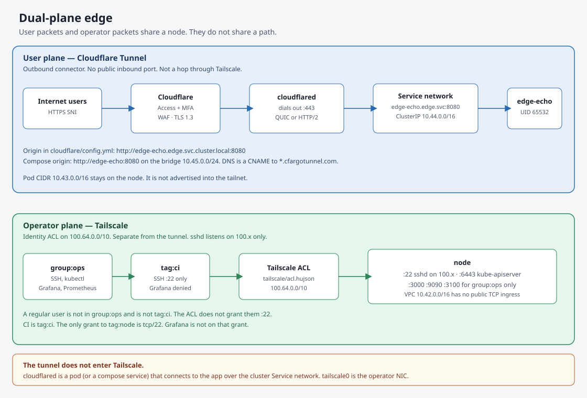

# Walkthrough

There is no hosted public application and no standing Cloudflare hostname
for this repository. The walkthrough is this page, the diagram, the lab
commands, and the 3-minute README recording of `git clone`, `make dev-up`,
`./scripts/zero-trust-verify.sh --compose`, and the Grafana Edge overview
dashboard on loopback (reached through an SSH tunnel in that recording).

A before-and-after write-up of open ports, attack surface, monthly cost,
and the MTU black hole is in [case-study.md](case-study.md).



## 1. Two planes

User packets and operator packets share a node. They do not share a path.

| Who | Path | What they do not traverse |
| --- | --- | --- |
| A person using the product | Cloudflare Access and WAF, then `cloudflared` dialing out on 443, then `http://edge-echo.edge.svc.cluster.local:8080` | Tailscale, and any public listener on the node |
| `group:ops` | Tailscale ACL to `100.x`: SSH, kubectl, Grafana, Prometheus | The tunnel |
| `tag:ci` | Tailscale ACL to `100.x` tcp/22 only | Grafana, Prometheus, the tunnel |

`cloudflare/config.yml` names the origin as the Kubernetes Service. It
does not name a Tailscale address. DNS for the product name is a CNAME to
`*.cfargotunnel.com`. There is no A record for the node.

Drawing with the CIDRs: [diagrams/dual-plane.svg](diagrams/dual-plane.svg).
Packet detail: [architecture.md](architecture.md).

## 2. Who is allowed to do what

Authentication, authorization, and reachability are three different
questions. The ACL file is `tailscale/acl.hujson`.

| Identity | Can reach | Cannot reach |
| --- | --- | --- |
| Someone who is not in the Access policy | Nothing on the origin. The lab proxy returns HTTP 403 and does not call the app. | SSH, Grafana |
| `group:dev` (a normal tailnet member, not ops) | The product only after Access, in the real design | Node SSH. The lab drops tcp/22. |
| `group:ops` | SSH, kubectl, Grafana, Prometheus, Loki on `100.x` | A grant they were not given. Port 8080 is not in the ops grant. |
| `tag:ci` | Node SSH, so it can apply manifests | Grafana (tcp/3000). The lab connection times out. |
| A pod that is not `cloudflared` and not a labeled probe | — | `edge-echo:8080`. The NetworkPolicy drops it. |

The lab that produces those results is not Cloudflare and not a tailnet.
It loads the policy files in this repo and enforces them with iptables
in network namespaces. Run it:

```bash
git clone https://github.com/Kikyo987/zero-trust-edge.git
cd zero-trust-edge
sudo ./security-tests/run.sh --lab
```

The report is `security-tests/reports/latest.md`. On a kernel that can
honor the setuid bit outside `/tmp`, the seven checks pass. `/tmp` is
not used for the setuid helper, because Ubuntu 26.10 mounts it `nosuid`.

Local compose, still with nothing on `0.0.0.0`:

```bash
cp docker/compose/.env.example docker/compose/.env
make dev-up
docker compose -f docker/compose/docker-compose.yml port edge-echo 8080
# 127.0.0.1:8080
curl -sS http://127.0.0.1:8080/healthz
# ok
./scripts/zero-trust-verify.sh --compose
```

## 3. A real public address, honestly

On 16 Nov 2026 a temporary Vultr lab VPS at `45.32.107.245` was scanned
from a different host. The machine had about 1 GiB of RAM, Ubuntu 26.10,
and UFW allowing only SSH. Cloudflare, Tailscale, and k3s were not
installed. The owner was going to shut it down after the test.

| Port | What was true on the VPS |
| --- | --- |
| 22 | **Open.** SSH was the only way in. A finished node would not look like this. |
| 80, 443 | **Not open.** Some scanner networks intercept outbound 80/443 and a connect() can look instant. No SYN for those ports arrived on the VPS, and nothing was listening. |
| 3000, 6443, 8080, 9090 | **Filtered** by UFW. |

Write-up: [evidence/lab-vps/README.md](evidence/lab-vps/README.md).

The `--production` run on that same box is not a pass. It skipped
Cloudflare, Tailscale, and kube-router because those variables and that
cluster were absent. Its nmap was a self-scan (0.00044 s) and is refused
by the harness now, because a self-scan bypasses UFW.

## 4. GET works, a large POST can still be a black hole

Overlays own the MTU. With a 1280-byte hop and ICMP fragmentation-needed
dropped, a small GET returns 200 and an 8 KB POST stalls. Restoring that
ICMP message makes the same POST return `ready`. The timestamps in the
narrative postmortem are invented. The lab commands are not.

```bash
sudo ./security-tests/lab/mtu-blackhole.sh
```

Transcript and capture from the cloud-agent lab:
[evidence/mtu-lab/transcript.txt](evidence/mtu-lab/transcript.txt),
[evidence/mtu-lab/pmtud-blackhole.pcap](evidence/mtu-lab/pmtud-blackhole.pcap).
The same script also passed on the temporary VPS. That box's capture was
not copied here, so it is not linked as if it were.

Full write-up, labeled simulated: [postmortem-example.md](postmortem-example.md).

## 5. What runs without you clicking deploy

Every pull request and every push to `main` runs `ci.yml` (Go, Terraform,
YAML, Trivy) and `security.yml` (the lab security checks and the MTU
reproduction). A push to `main` also runs `deploy.yml` against the
**staging** environment only. If that environment has no Tailscale
secrets, the remote steps are skipped and the workflow stays green.
Production is a manual `workflow_dispatch` choice, and it keeps GitHub
Environment protection. Nothing in CI dials a live Cloudflare account.

## 6. What this walkthrough does not contain

- A public URL for the app. Do not look for one.
- A Cloudflare Access login or an MFA prompt from a real tenant.
- A Tailscale admin console.
- A claim that port 22 was closed on `45.32.107.245`. It was not.
