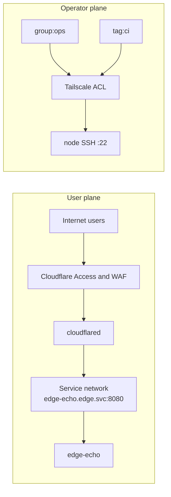

# 3-minute walkthrough

No video host. This page is the demo: packet path, then commands you can run.

## 1. Packet path (~30 s)

Two planes. The tunnel does not enter Tailscale, and Tailscale is not how a user reaches the app.



- Users never SYN the origin. Cloudflare Access is the identity check. **cloudflared** dials Cloudflare, then the app on the cluster Service or the compose DNS name.
- Operators and CI never use public `:22`. **Tailscale** ACL tags (`group:ops`, `tag:ci`) are a second door, onto `100.x` only.
- The node has **no public inbound ports**. Traefik / Compose bind ClusterIP or `127.0.0.1`.

Drawing with CIDRs: [diagrams/dual-plane.svg](diagrams/dual-plane.svg).

## 2. Prove it locally (~90 s)

```bash
git clone https://github.com/Kikyo987/zero-trust-edge.git
cd zero-trust-edge
cp docker/compose/.env.example docker/compose/.env
make dev-up
```

| Command | Expected |
| --- | --- |
| `docker compose -f docker/compose/docker-compose.yml port edge-echo 8080` | `127.0.0.1:8080` |
| `curl -sS http://127.0.0.1:8080/healthz` | `ok` |
| `./scripts/zero-trust-verify.sh --compose` | `RESULT  PASS  no public inbound ports` |

If `port` prints `0.0.0.0:8080`, the inbound posture is wrong.

Grafana (also loopback): http://127.0.0.1:3000 → dashboard **Edge overview**. `up` should be green for `edge-echo` and `prometheus`.

## 3. What you do **not** see (~30 s)

- No A/AAAA for the node in DNS (`app.example.com` is a CNAME to `*.cfargotunnel.com`).
- No SG rule for `0.0.0.0/0` TCP 22/80/443 (`terraform/modules/security`).
- Deploy is **manual** (`workflow_dispatch`). Push to `main` only builds and runs Trivy.

Longer form: [architecture.md](architecture.md) · [ADR 0001](adr/0001-zero-trust-edge.md) · [tunnel-and-access.md](../cloudflare/tunnel-and-access.md)

<!-- Optional: record a Loom of the same three steps and swap the README Demo link to that URL. -->
